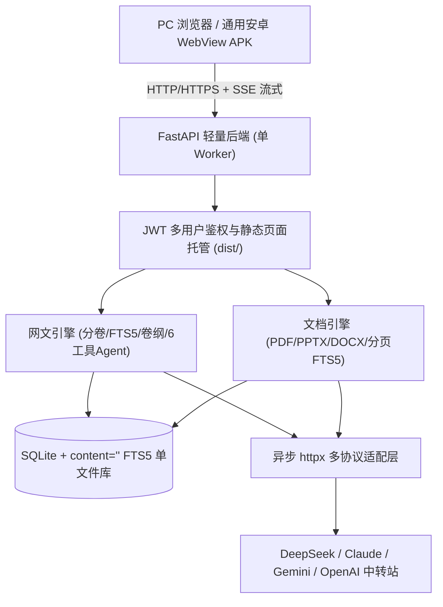

[简体中文](README.md) | [English](README_EN.md)

# ScrollLens（卷镜）

> 一款面向个人自部署与开源社区的**极轻量、零成本入库、多用户隔离、自带 API Key（BYOK）**双模式 AI 问答与资料查证工具，专为 **2000 万字级超长连载网文**与**日常办公/学习文档**打造。提供 **Web 工作台 + 通用开源安卓 WebView APK**。

---

## 核心特性

### 1. 网文深读与防剧透查书引擎
- **多格式与原书结构还原**：支持 `TXT`（自动探测 `UTF-8` / `GB18030` / `GBK` 与网站水印清洗）、`EPUB`（解析 `toc.ncx` / `nav.xhtml` 两级嵌套目录）、`MOBI` / `AZW3` / `AZW`、`FB2`（两级 `<section>` 目录）、`PDF`（优先还原书签目录）、`DOCX`（Heading 1/2 分卷章节）、`Markdown`、`HTML` 与 `ZIP` 打包小说，自动按原书**分卷 → 章节**入库；无分卷作品支持手动切分卷界。
- **PC 端拖拽导入与连载追更**：PC 浏览器支持单文件/多文件直接拖拽至工作台批量入库；将最新小说文件直接拖拽至左侧书架对应书籍卡片，即可触发**连载增量追更**（自动比对尾章指纹，仅追加新增章节并更新分卷范围）。
- **零成本无冗余 FTS5 索引**：采用 SQLite FTS5 `content=''` 外置倒排索引（兼容 SQLite 3.37+），结合单实例 `jieba` 搜索引擎分词与动态别名保留，入库无需调用任何大模型或向量库（**0 元入库成本**）。
- **严格防剧透进度锁**：随时设定已读章号 `read_progress_ch`；查书 Agent、章节读取、关键词时间轴与未读完卷纲均硬性锁定在进度范围内，彻底杜绝剧透。
- **别名映射与设定本**：支持角色/势力别名表（如 `韩萧 -> 黑星 / 黑星阁下`）并自动扩展检索；支持懒加载分类设定卡片（人物/军团/势力/物品/事件）。
- **可选分卷卷纲**：按需单卷或批量异步生成卷纲（`>15 万字` 超长卷自动分段压缩，支持暂停与断点续跑）。
- **6 工具 Agent 查书循环**：`list_volumes` → `get_keyword_timeline` → `search_chapters` → `list_chapter_titles` → `read_chapter` → `query_wiki_notes`，内置最多 5 轮工具调用与 18,000 字输出硬熔断，回答附带可点击 `[ch:N]` 章节溯源。

### 2. 日常办公与学习文档引擎
- **多格式纯文字解析**：原生支持 `PDF`（PyMuPDF）、`PPTX`（含表格与演讲者备注）、`DOCX`（含表格）、`Markdown` 与 `TXT`。
- **大小文档智能分流**：`< 40,000` 字小文档全文无损直读；`≥ 40,000` 字自动切换分页 FTS5 + Agent 工具检索，回答附带 `[p:页码]` 溯源。
- **疑似扫描页检测与多模态视觉 OCR**：自动计算每页文字密度 `text_density`，标记低字数含图页并缓存扫描页图像；支持直接调用用户已配置的多模态视觉模型（OpenAI 兼容 / Anthropic / Gemini 原生三协议均支持）按页或批量异步执行 OCR 识图，识别结果自动回写正文与 FTS5 索引。

### 3. 多模型与中转站适配（BYOK）
- **三协议原生流式支持**：基于异步 `httpx` 原生实现 `OpenAI 兼容`（DeepSeek / ChatGPT / 通义千问 / 硅基流动 / OpenRouter / One-API / New-API 等中转站）、`Anthropic 原生`（Claude）与 `Google Gemini 原生`。
- **一键自检与降级**：支持自动拉取模型列表、两级连通性 + Tool Calling 能力检测，以及针对非原生工具协议中转站的 **ReAct 文本协议降级模式**。
- **多用户隔离与加密存储**：首个注册用户自动成为管理员，可开关公开注册、设置邀请码与单文件大小上限；所有业务数据按 `user_id` 隔离，API Key 使用服务端 Fernet 对称加密落库。

### 4. 现代双端界面与通用安卓 APK
- **Web 工作台**：React + Vite + Tailwind CSS + Zustand 实现数据层与视觉层彻底解耦；与安卓图标同源的深墨蓝/晴空蓝品牌体系、支持浅色纸墨与深色夜读双主题、内置 React Bits 风格 `PromptBar`（`/` 快捷指令面板、内嵌防剧透气泡、模型切换与 `100dvh` 移动端键盘安全区适配）。
- **通用开源安卓壳（`android-shell/`）**：极简 Kotlin WebView 容器（包名 `io.github.scrolllens.app`），**不写死任何服务器 IP**，支持多服务器管理与 `/api/v1/health` 检测、文件选择器上传、实体返回键控制及 `window.ScrollLensApp.openServerConfig()` JS Bridge。

---

## 系统架构



---

## 实测性能基准

以下数据均来自本仓库实测（`Python 3.12` + `SQLite FTS5`）：

| 测试场景 | 规模 | 解析与入库耗时 | 磁盘体积比 | 检索延迟 | 进程内存 (RSS) |
| :--- | :--- | :--- | :--- | :--- | :--- |
| **500 万字压测 TXT**（自动化测试） | 12 卷 / 1,200 章 | `< 15 s` | `1.243x` 原始文本 | `13.3 ms` | **`122.6 MiB`** |
| **真实 Z-Library EPUB《超神机械师》** | 15 卷 / 1,465 章 / 543 万字 | 解析 `3.21 s` + 入库 `12.99 s` | `0.998x`（28.52 MB 库 vs 28.57 MB EPUB） | `138.1 ms`（含全书时间轴） | **`124.9 MiB`**（DeepSeek 4 轮工具问答 `7.97 s`） |

> 即使在 **2 vCPU / 2 GiB 内存** 的轻量云主机（如阿里云 ECS）上，常驻内存仍可稳定控制在 **180 MiB 预算内**。

---

## 快速开始（本地开发与体验）

### 环境要求
- Python `3.10+`（推荐 `3.12`）
- Node.js `20+`（仅修改前端或重新打包 `frontend/dist/` 时需要）

### 1. 启动后端与托管前端
```bash
# 1. 进入后端目录并创建虚拟环境
cd backend
python -m venv .venv

# Windows PowerShell 激活并安装依赖：
.\.venv\Scripts\Activate.ps1
# Linux / macOS 激活：
# source .venv/bin/activate

pip install -e ".[dev]"

# 2. 打包前端静态资源（FastAPI 会自动托管 frontend/dist）
cd ../frontend
npm ci
npm run build

# 3. 启动服务
cd ../backend
uvicorn app.main:app --reload --host 127.0.0.1 --port 8000
```
打开浏览器访问 `http://127.0.0.1:8000`（首个注册账号自动成为管理员）。

> 如需前端热更新开发：保持后端运行在 `8000` 端口，在 `frontend/` 下运行 `npm run dev`，访问 `http://127.0.0.1:5173`（已配置 `/api` 反向代理）。

### 2. 运行自动化测试与实机冒烟脚本
```bash
cd backend
# 运行全量单元测试、集成测试与 500 万字压测
pytest tests -v

# 用你自己的真实 TXT / EPUB 小说与 API Key 做端到端冒烟验证
python scripts/smoke_test_live.py --novel "path/to/novel.epub" --keyword "主角名"
python scripts/smoke_test_live.py --protocol openai_compat --base-url "https://api.deepseek.com/v1" --api-key "sk-xxx" --model "deepseek-chat"
```

---

## 生产部署（Ubuntu 22.04 ECS / Docker）

### 方式一：Ubuntu 一键部署（推荐用于 2GB 内存 VPS）
将仓库拉取到 `/opt/scroll-lens`（确保已在本地先执行 `frontend/` 的 `npm run build` 并上传 `frontend/dist/`）：
```bash
sudo bash /opt/scroll-lens/deploy/install-ecs.sh
```
脚本会自动检查 Python 3.10+、创建 `venv`、生成随机 `APP_SECRET_KEY` 写入 `deploy/.env`、配置 `systemd` 常驻（`MemoryMax=250M`，单 Worker）并验证 `/api/v1/health`。
反向代理请参考 [`deploy/nginx.conf.example`](deploy/nginx.conf.example)（已包含 `client_max_body_size 120M` 与 SSE 禁用缓冲 `proxy_buffering off`）。

### 方式二：Docker Compose
```bash
cd deploy
cp .env.example .env   # 填入随机长密钥 APP_SECRET_KEY
docker compose up -d --build
```

---

## 通用安卓 APK 云端自动打包

无需本地安装 Android Studio：
1. 推送 `v*` 标签（例如 `git tag v1.0.0 && git push origin v1.0.0`），或在 GitHub 仓库 **Actions → Build Universal Android APK** 手动触发。
2. GitHub Actions 会自动运行安卓单元测试并构建通用包 `ScrollLens-<version>-universal.apk`（支持可选 Release 签名 Secrets：`ANDROID_KEYSTORE_BASE64`、`ANDROID_KEYSTORE_PASSWORD`、`ANDROID_KEY_ALIAS`、`ANDROID_KEY_PASSWORD`）。
3. 手机安装 APK 后，首次打开输入你的电脑局域网地址或云服务器地址测试连通性即可使用。

---

## 仓库目录与文档索引

```text
scroll-lens/
├── backend/                  # Python FastAPI 后端、双模式引擎、SQLite FTS5 与测试集
├── frontend/                 # React + Vite + Tailwind + Zustand 前端工程
├── android-shell/            # 通用开源 Kotlin WebView 安卓套壳工程
├── deploy/                   # ECS 一键部署脚本、systemd 模板、Nginx 示例与 Docker 配置
├── .github/workflows/        # 后端 CI 与安卓 APK 自动构建发布工作流
├── docs/
│   ├── design_doc.md         # v1.1 技术设计文档
│   ├── FRONTEND_HANDOFF.md   # 前后端 REST / SSE 接口契约说明
│   └── UI_DESIGN_SYSTEM.md   # 前端视觉系统与迭代规范
├── LICENSE                   # MIT License
├── README.md                 # 中文文档
└── README_EN.md              # English Documentation
```

## 开源协议

本项目基于 [MIT License](LICENSE) 开源。
