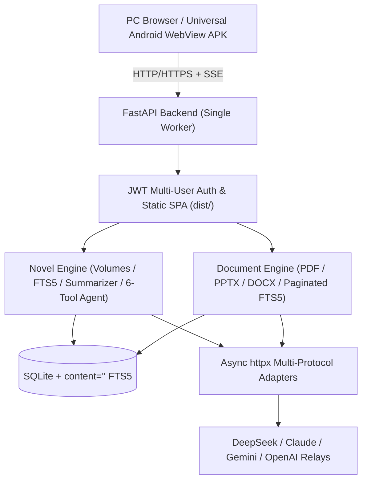

[简体中文](README.md) | [English](README_EN.md)

# ScrollLens

> An ultra-lightweight, zero-cost-indexing, multi-user isolated, **Bring-Your-Own-Key (BYOK)** dual-mode AI reading & Q&A workbench built for **20M+ character serialized web novels** and **everyday office/study documents**. Ships with a **Web Workbench + Universal Open-Source Android WebView APK**.

---

## Key Features

### 1. Web Novel Deep-Reading & Anti-Spoiler Engine
- **Native Volume & Chapter Hierarchy**: Parses `TXT` (auto-detecting `UTF-8` / `GB18030` / `GBK` with web watermark cleanup) and `EPUB` (reconstructing two-level `toc.ncx` / `nav.xhtml` volume trees). Supports manual volume splitting for volume-less books.
- **Incremental Serialization Append**: Re-importing updated `TXT`/`EPUB` files aligns trailing chapter fingerprints and appends only newly published chapters.
- **Zero-Cost, Zero-Bloat FTS5 Indexing**: Uses contentless SQLite FTS5 (`content=''`, compatible with SQLite 3.37+) paired with `jieba` search segmentation and alias preservation — **zero LLM/embedding API cost at ingestion**.
- **Strict Anti-Spoiler Progress Lock**: Set your current chapter (`read_progress_ch`) at any time. All agent tools, chapter lookups, keyword timelines, and volume summaries beyond your progress are strictly locked out.
- **Alias Expansion & Wiki Notes**: Define entity alias groups (e.g., `Canonical -> Alias1 / Alias2`) for automatic query expansion and FTS5 re-indexing, plus categorized Markdown lore cards.
- **Optional Volume Summarizer**: On-demand single-volume or batch async summarization (`>150k` chars automatically chunked and merged, with pause/resume support).
- **6-Tool Book Investigation Agent**: `list_volumes`, `get_keyword_timeline`, `search_chapters`, `list_chapter_titles`, `read_chapter`, and `query_wiki_notes`, bounded by a hard 5-round / 18,000-char fuse with clickable `[ch:N]` citations.

### 2. Everyday Document Engine
- **Multi-Format Plain-Text Parsing**: Native support for `PDF` (PyMuPDF), `PPTX` (including tables & speaker notes), `DOCX` (including tables), `Markdown`, and `TXT`.
- **Smart Context Routing**: Documents under `40,000` characters are injected losslessly into context; larger documents automatically switch to paginated FTS5 + Agent retrieval with clickable `[p:N]` page citations.
- **Scanned-Page Detection & v1.1 Vision Hook**: Computes per-page `text_density`, flags low-text image pages in the UI, and reserves `BasePageExtractor.extract_with_vision()` for future multimodal OCR.

### 3. Multi-Protocol LLM Layer (BYOK)
- **Three Native Streaming Protocols**: Built on async `httpx` supporting `OpenAI-compatible` endpoints (DeepSeek, ChatGPT, Qwen, SiliconFlow, OpenRouter, One-API / New-API relays), `Anthropic` native (Claude), and `Google Gemini` native.
- **Model Discovery & Two-Stage Probe**: Auto-fetches model lists, runs connectivity + native Tool Calling self-tests, and supports **ReAct text-protocol fallback** for relays without native tool-call support.
- **Multi-User Isolation & Encrypted Secrets**: The first registered user automatically becomes `admin` (controlling public registration, invite codes, and upload size limits). All user data is strictly isolated by `user_id`, and API keys are stored encrypted with Fernet.

### 4. Dual-Platform UI & Universal Android APK
- **Modern Web Workbench**: Decoupled React + Vite + Tailwind CSS + Zustand architecture (`types/`, `api/`, and `stores/` strictly separated from UI components), warm paper light theme & neutral charcoal dark theme matching the Android brand icon, React Bits-inspired `PromptBar` (`/` slash command palette, inline spoiler-lock popover, quick file upload, model picker), and `100dvh` + safe-area mobile responsiveness.
- **Universal Android WebView Shell (`android-shell/`)**: Lightweight Kotlin container (`io.github.scrolllens.app`) with **no hardcoded server IP** — configure & health-check multiple servers (`/api/v1/health`), upload files via native file picker, navigate with hardware back button, and jump back to server config via `window.ScrollLensApp.openServerConfig()`.

---

## Architecture



---

## Verified Benchmarks

Measured locally on `Python 3.12` + `SQLite FTS5`:

| Benchmark | Scale | Parse & Index Time | DB Size Ratio | Query Latency | Process RSS |
| :--- | :--- | :--- | :--- | :--- | :--- |
| **5M-Char Stress TXT** (`pytest`) | 12 vols / 1,200 chaps | `< 15 s` | `1.243x` raw text | `13.3 ms` | **`122.6 MiB`** |
| **Real 5.43M-Char EPUB** | 15 vols / 1,465 chaps | `3.21 s` parse + `12.99 s` index | `0.998x` (28.52 MB DB vs 28.57 MB EPUB) | `138.1 ms` (search + timeline) | **`124.9 MiB`** (live DeepSeek 4-round Q&A in `7.97 s`) |

> Designed to run comfortably within a **≤ 180 MiB RAM** budget on lightweight **2 vCPU / 2 GiB** cloud instances.

---

## Quick Start (Local Development)

### Prerequisites
- Python `3.10+` (`3.12` recommended)
- Node.js `20+` (only required when developing or building `frontend/dist/`)

### 1. Build Frontend & Run Backend
```bash
# 1. Set up backend virtualenv
cd backend
python -m venv .venv
# Windows PowerShell: .\.venv\Scripts\Activate.ps1
# Linux / macOS: source .venv/bin/activate
pip install -e ".[dev]"

# 2. Build static frontend bundle (served automatically by FastAPI)
cd ../frontend
npm ci
npm run build

# 3. Start FastAPI server
cd ../backend
uvicorn app.main:app --reload --host 127.0.0.1 --port 8000
```
Open `http://127.0.0.1:8000` in your browser (the first registered account becomes administrator).

> For frontend hot-reload during UI development: run `npm run dev` in `frontend/` and open `http://127.0.0.1:5173` (requests to `/api` are proxied to port `8000`).

### 2. Run Tests & Live Smoke CLI
```bash
cd backend
pytest tests -v

# Benchmark your own real TXT / EPUB novel and/or live LLM API key
python scripts/smoke_test_live.py --novel "path/to/novel.epub" --keyword "Protagonist"
python scripts/smoke_test_live.py --protocol openai_compat --base-url "https://api.deepseek.com/v1" --api-key "sk-xxx" --model "deepseek-chat"
```

---

## Production Deployment (Ubuntu 22.04 ECS / Docker)

### Option A: Ubuntu One-Click Script (2 GiB VPS)
Clone/upload the repo (including locally built `frontend/dist/`) to `/opt/scroll-lens` and run:
```bash
sudo bash /opt/scroll-lens/deploy/install-ecs.sh
```
See [`deploy/nginx.conf.example`](deploy/nginx.conf.example) for Nginx reverse proxy settings (`client_max_body_size 120M` and `proxy_buffering off` for SSE streaming).

### Option B: Docker Compose
```bash
cd deploy
cp .env.example .env   # Set a strong random APP_SECRET_KEY
docker compose up -d --build
```

---

## Building the Universal Android APK via GitHub Actions

No local Android Studio installation required:
1. Push a `v*` tag (`git tag v1.0.0 && git push origin v1.0.0`) or manually trigger **Actions → Build Universal Android APK**.
2. The workflow runs Android unit tests and outputs `ScrollLens-<version>-universal.apk` (uses release keystore secrets `ANDROID_KEYSTORE_BASE64`, `ANDROID_KEYSTORE_PASSWORD`, `ANDROID_KEY_ALIAS`, `ANDROID_KEY_PASSWORD` if configured, or builds a universal debug APK otherwise).

---

## Repository Structure

```text
scroll-lens/
├── backend/                  # FastAPI backend, dual-mode engines, SQLite FTS5, tests & smoke CLI
├── frontend/                 # React + Vite + Tailwind + Zustand web application
├── android-shell/            # Universal Kotlin WebView Android wrapper
├── deploy/                   # ECS install script, systemd unit, Nginx example, Dockerfile & Compose
├── .github/workflows/        # Backend CI & Android APK release automation
├── docs/
│   ├── design_doc.md         # Architecture & v1.1 design specification
│   ├── FRONTEND_HANDOFF.md   # REST & SSE API contract reference
│   └── UI_DESIGN_SYSTEM.md   # UI design system & maintenance guide
├── LICENSE                   # MIT License
├── README.md                 # Chinese README
└── README_EN.md              # English README
```

## License

Released under the [MIT License](LICENSE).
