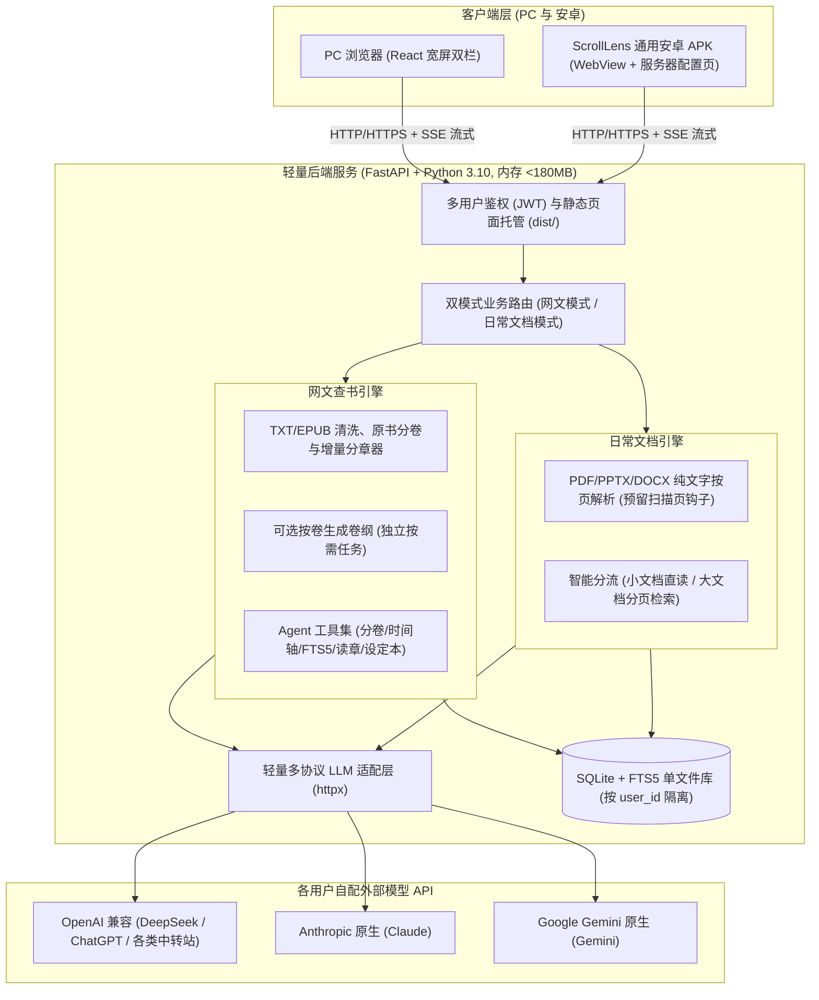
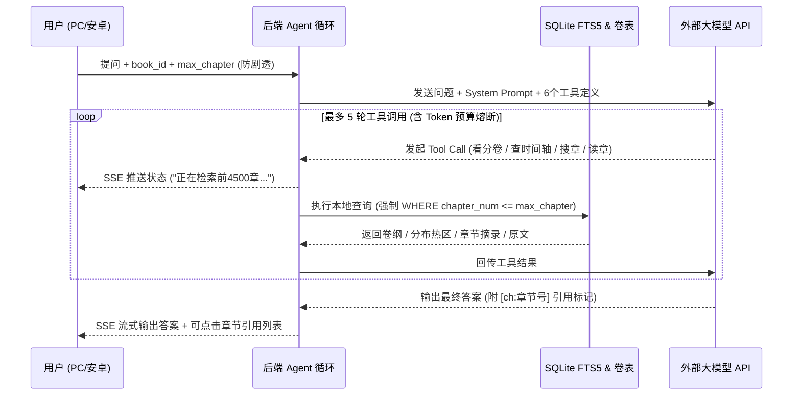

# ScrollLens（卷镜）— 技术设计文档 (v1.1 定稿)

> **项目名称**：**ScrollLens（卷镜）**（仓库名：`scroll-lens`｜安卓包名：`io.github.scrolllens.app`｜协议：**MIT License**）
> **寓意**：“卷”指网文分卷与日常案卷，“镜”指洞悉千万字剧情脉络、照见人物设定与文档要点的轻量透镜。
> **核心定位**：一款面向个人自部署与开源社区的**极轻量、低成本、多用户隔离、自带 API Key（BYOK）**双模式 AI 问答工具，专为 **2000 万字级超长连载网文**与**日常办公/学习文档**设计，提供 **PC 网页端 + 通用开源安卓套壳 APK**。

---

## 1. 设计目标与硬性约束

### 1.1 已拍板的产品决策
1. **多用户与安全隔离**：支持多用户注册与严格数据隔离（各自的书架、文档、对话、API Key 互不可见）；**首个注册用户自动成为管理员**，支持通过 `.env` 或后台开关控制 `ALLOW_REGISTRATION`（自部署在个人服务器时可一键关闭公开注册或开启邀请码，防陌生人刷爆磁盘）。
2. **双模式切换**：
   - **网文模式**：导入 `TXT` / `EPUB` 及连载追更；**按原书分卷自动结构化**，支持可选按卷生成卷纲；内置防剧透进度锁、别名表、懒加载设定本与可点击章节溯源。
   - **日常文档模式**：v1.0 支持纯文字型 `PDF` / `PPTX` / `DOCX` / `MD` / `TXT`；底层预留“低文字密度页标记（扫描版 PDF / 纯图片 PPT）”扩展点，便于 v1.1 无缝接入多模态视觉模型识图。
3. **前端技术栈与协作分工**：采用 **React + Vite + Tailwind CSS (TypeScript)**，严格分离“业务逻辑/接口层”与“UI 视觉组件层”，方便专门做前端审美打磨而不破坏核心逻辑；本地打包静态 `dist/` 上传服务器，服务器零 Node 依赖。
4. **多模型与中转站（BYOK）**：原生支持 **DeepSeek、Claude、Gemini、ChatGPT** 及各类 OpenAI 兼容中转站，带模型列表自动拉取与 Tool Calling 连通性自检。
5. **通用开源安卓套壳 APK**：不硬编码任何服务器 IP，首次打开配置服务器地址即可全屏使用，配合 GitHub Actions 自动构建发布。

### 1.2 服务器硬件硬约束（阿里云 ECS 实测基准）
根据当前阿里云 ECS（Ubuntu 22.04，2 vCPU）资源快照，架构严格遵守以下预算：

| 资源项 | 服务器当前余量 | 本系统设计预算 | 架构选型约束 |
| :--- | :--- | :--- | :--- |
| **可用物理内存** | ~879 MiB（总 1.63 GiB） | **≤ 180 MiB** | 禁止引入 PyTorch、本地 Embedding 模型、重型向量库、LangChain/LiteLLM |
| **剩余磁盘空间** | ~11 GiB（总 40 GiB） | **≤ 2 GiB**（含多本千万字小说） | 采用 `content=''` 无冗余文本的 SQLite FTS5 外置索引；主机 Python `venv` + `systemd` 轻量运行 |
| **构建环境** | 无 Node/npm | 服务器 0 编译开销 | 前端在本地 Windows 打包 `dist/` 后由 FastAPI 直接托管 |

---

## 2. 总体系统架构



---

## 3. 数据库设计（单文件 SQLite，全表多用户隔离）

所有业务表均含 `user_id`（外键关联 `users.id`），并在接口层强制校验归属权，确保多用户间 100% 隔离。

### 3.1 核心表结构

| 表名 | 用途 | 关键字段 |
| :--- | :--- | :--- |
| `users` | 用户账号 | `id`, `username` (唯一), `password_hash` (Argon2/PBKDF2), `role` (`admin`/`user`), `is_active`, `created_at` |
| `system_settings` | 系统全局配置 | `key`, `value`（如 `allow_registration`, `invite_code`, `max_upload_mb`） |
| `books` | 小说书架 | `id`, `user_id`, `title`, `author`, `total_volumes`, `total_chapters`, `total_chars`, `read_progress_ch` (防剧透章号), `created_at`, `updated_at` |
| `volumes` | **原书分卷与卷纲** | `id`, `book_id`, `volume_num`, `title` (如 `第一卷 初入乱世`), `start_chapter`, `end_chapter`, `summary_md` (可选生成), `summary_status` (`none`/`generating`/`ready`) |
| `chapters` | 小说章节正文 | `id`, `book_id`, `volume_id`, `chapter_num`, `title`, `content`, `char_count` |
| `chapters_fts` | 网文全文倒排索引 | FTS5 虚拟表（`content=''` 无冗余存储，存 `jieba` 分词后的 `title` + `segmented_content`，带 `chapter_id`, `book_id`, `chapter_num`） |
| `book_aliases` | 角色/势力别名表 | `id`, `book_id`, `canonical_name` (主名，如 `陈曦`), `aliases_json` (如 `["陈子川","司空"]`) |
| `wiki_notes` | 懒加载设定卡片 | `id`, `book_id`, `entity_name`, `category` (人物/军团/势力/物品/事件), `content_md`, `source_chapters_json`, `updated_at` |
| `documents` | 日常文档列表 | `id`, `user_id`, `filename`, `file_type` (`pdf`/`pptx`/`docx`/`md`/`txt`), `total_pages`, `total_chars`, `has_scanned_pages` (v1.1 扩展标识), `created_at` |
| `doc_pages` | 文档分页内容 | `id`, `doc_id`, `page_num`, `heading`, `content`, `text_density` (低字数页标记，供后续视觉 OCR 识别) |
| `doc_pages_fts` | 文档分页倒排索引 | FTS5 虚拟表，支持超大 PDF/PPT 分页检索 |
| `llm_providers` | 用户私密 API 配置 | `id`, `user_id`, `name`, `protocol` (`openai_compat`/`anthropic`/`gemini`), `base_url`, `api_key_enc` (服务端对称加密存储), `model_name`, `is_default`, `supports_tools` |
| `chat_sessions` | 对话会话 | `id`, `user_id`, `mode` (`novel`/`document`), `target_id`, `title`, `created_at` |
| `chat_messages` | 对话记录 | `id`, `session_id`, `role`, `content`, `tool_trace_json`, `citations_json`, `created_at` |

---

## 4. 核心引擎详细设计

### 4.1 网文入库、原书分卷与中文检索（0 成本处理 2500 万字）

1. **编码与清洗**：自动探测 `UTF-8 / GB18030 / GBK`，清除常见网站水印、多余空行与非法控制字符。
2. **两级结构解析（原书分卷 → 章节）**：
   - **TXT 分卷识别**：独立识别卷标题正则（如 `^第[零一二三四五六七八九十百千万0-9]+[卷部篇册集].*`、`^卷[零一二三四五六七八九十0-9]+.*`、`^【.*?卷】.*`），将后续章节自动归属至当前卷；同时记录每卷的 `start_chapter` 与 `end_chapter`。
   - **EPUB 分卷识别**：直接读取 EPUB `toc.ncx` / `nav.xhtml` 的两级嵌套目录树还原原书分卷结构。
   - **无分卷兜底**：若某本 TXT 原文完全没有“卷”标记，自动归入 `第一卷 正文`，并允许用户在书架页手动新增自定义分卷切分点。
   - **连载增量追更**：重新导入最新 TXT 时，自动比对已有最新章节指纹，仅追加新增章节并自动更新最后一卷的 `end_chapter`（或创建新卷）。
3. **中文 FTS5 零冗余索引**：
   - 使用 `jieba.cut_for_search`（搜索引擎模式分词）并动态注入当前书籍的 `book_aliases` 词典，避免“陈曦”“白马义从”“内气离体”等专有名词被误拆。
   - 流式逐章写入 SQLite，2450 万字《神话版三国》入库耗时约 **10～25 秒**，总占盘约 **220～280 MB**，入库 API 成本 **0 元**。
   - 查询时自动展开别名映射（如搜 `陈子川` 自动扩展为 `陈子川 OR 陈曦`），未命中时在限定章节范围内回退至 `LIKE` 精确子串扫描兜底。

### 4.2 额外可选功能：按原书分卷生成「卷纲」
- **触发方式**：完全可选、用户手动触发（支持**单卷生成**或**一键队列批量生成**，后台异步执行并实时展示进度，支持中途暂停/断点续跑，可指定最便宜的模型如 DeepSeek Flash）。
- **单卷压缩策略（应对超长卷）**：
  - 若某卷字数 ≤ 15 万字：提取该卷所有章节标题 + 每章首尾关键段/高频实体，单次总结出结构化卷纲（主线剧情、核心登场人物、重要势力/战力变化）。
  - 若某卷字数 > 15 万字（如大长篇的一卷有 300 章）：先按卷内子段（每 25～30 章）做轻量小结，再归并成该卷总纲，避免超出模型上下文。
- **防剧透严格联动**：当用户的 `read_progress_ch` 落在某一卷中间（例如某卷是第 4000～4600 章，但用户只看到 4500 章），Agent **绝对禁止读取尚未读完卷的卷纲**，只允许读取 `end_chapter <= read_progress_ch` 的已读完卷纲，彻底杜绝卷纲剧透！

### 4.3 网文 Agent 查书工具集（6 个核心工具）



| 工具名 | 参数 | 核心作用 |
| :--- | :--- | :--- |
| `list_volumes` | `max_chapter` | 返回原书分卷目录（含每卷起止章号；若已生成卷纲且 `end_chapter <= max_chapter`，同步附带卷纲摘要） |
| `get_keyword_timeline` | `keyword`, `max_chapter`, `buckets=20` | 统计关键词首次出场章、末次出场章、总频次及全书热区分布（瞬间定位跨千章演变节点） |
| `search_chapters` | `keywords[]`, `match_mode` (`AND`/`OR`), `volume_num`(可选), `start_ch`, `end_ch`, `limit=15` | 精准检索单关键词、多角色交集或指定卷内章节，返回命中前后 150 字摘录 |
| `list_chapter_titles` | `start_ch`, `end_ch` | 浏览指定区间的章节标题（单次最多 100 条） |
| `read_chapter` | `chapter_num`, `focus_keyword`(可选), `max_chars=2500` | 精读指定章原文（或围绕关键词截取上下文） |
| `query_wiki_notes` | `entity_name` | 检索本地已保存的人物/势力/军团设定卡片 |

**成本与防死循环硬熔断**：单次提问最多 `5` 轮工具调用，累计注入工具文本硬上限 `18,000` 字（约 1.2～1.5 万 Token），单次提问费用稳定在 **2～6 分钱**。

### 4.4 日常文档模式（v1.0 纯文字 + v1.1 扫描识图预留）
- **v1.0 解析器**：`PyMuPDF`（PDF）、`python-pptx`（PPTX，含备注与表格）、`python-docx`（DOCX，含标题与表格）、纯文本 `MD`/`TXT`。
- **智能分流**：总字数 `< 40,000` 字直接全文塞上下文（无损精读）；`≥ 40,000` 字自动切为分页 FTS5 + Agent 检索模式，引用标注 `[p:页码]`。
- **v1.1 扫描版 PDF / 纯图片 PPT 预留设计**：
  - 在 `ParserD` 解析每页时自动计算文字密度 `text_density`；若 PDF 某页提取字数 < 20 字且包含内嵌图片，或 PPTX 某页仅有图片无文本框，自动标记 `has_scanned_pages = true`。
  - 前端在文档详情中温和提示“检测到 X 页疑似扫描图/纯图页，当前版本仅解析纯文字（视觉识图将在后续版本开放）”；后端 `BasePageExtractor` 预留 `extract_with_vision(page_image, provider)` 抽象方法，后续无需改表即可平滑升级。

### 4.5 多模型与中转站适配层（BYOK）
基于异步 `httpx` 实现 3 套轻量协议适配器：
1. **`openai_compat`**：覆盖 DeepSeek、ChatGPT、Qwen、硅基流动、OpenRouter 及几乎所有 One-API / New-API 中转站，支持一键厂商预设与 `GET /v1/models` 自动拉取模型列表。
2. **`anthropic`**：Claude 官方及原生 Anthropic 协议中转站。
3. **`gemini`**：Google Gemini 官方 API（原生协议与兼容端点均支持）。
- **两级自检**：设置页内置「测试连通性 + Tool Calling 能力检测」；同时支持为不兼容原生 Tool Calling 的廉价中转站开启 **ReAct 文本协议降级模式**。
- **密钥加密存储**：用户填入的 API Key 使用服务端 `APP_SECRET_KEY`（Fernet 对称加密）加密落库，前端列表仅脱敏回显末尾 4 位。

---

## 5. 前后端解耦架构与 API 契约（便于前端视觉独立打磨）

为了让你能放心地把**“前端审美与视觉组件”**交给合作者打磨，同时保证核心逻辑零侵入，前端（`frontend/`）采用严格分层目录：

```text
frontend/src/
├── api/                 # 纯接口与 SSE 流式解析客户端（后端契约锁死，改样式无需动这里）
├── stores/              # Zustand 轻量状态管理（登录态、当前模式、防剧透章号、会话流）
├── types/               # TypeScript 数据结构定义
├── components/          # 视觉组件层（完全自由调整排版、配色、动效与手机手感）
│   ├── layout/          # 顶栏模式切换、手机抽屉 / PC 侧边栏
│   ├── novel/           # 书架卡片、分卷大纲抽屉、防剧透进度条、原文弹窗、设定卡
│   ├── document/        # 文档上传区、页码引用弹窗
│   ├── chat/            # 聊天气泡、工具调用折叠胶囊、Markdown 与 [ch:N] 引用渲染
│   └── settings/        # 多模型/中转站预设卡片、一键测试按钮、管理员开关
└── pages/               # 登录/注册页、主工作台、设置页
```

### 核心 REST & SSE 接口一览

| 模块 | 路径 | 方法 | 说明 |
| :--- | :--- | :--- | :--- |
| **账号与注册** | `/api/v1/auth/register` / `login` / `me` | `POST` / `GET` | 注册（受开关/邀请码控制）、登录签发 JWT、获取当前用户与角色 |
| **管理员设置** | `/api/v1/admin/settings` | `GET` / `PATCH` | 仅 `admin` 可调用：开关公开注册、设置邀请码、单文件大小上限 |
| **网文与分卷** | `/api/v1/books` & `/books/{id}/append` | `GET` / `POST` | 书架列表 / 上传 TXT, EPUB / 连载增量追加 |
| **分卷与卷纲** | `/api/v1/books/{id}/volumes` & `/volumes/{vid}/summarize` | `GET` / `POST` | 查看原书分卷列表 / 触发单卷或全书卷纲异步生成（带进度轮询） |
| **进度与别名** | `/api/v1/books/{id}/settings` | `PATCH` | 更新 `read_progress_ch`、管理别名映射表 |
| **原文与设定集** | `/api/v1/books/{id}/chapters/{num}` & `/wiki` | `GET` / `POST` / `DELETE` | 原文阅读弹窗（带关键词高亮）/ 设定集卡片增删改查 |
| **日常文档** | `/api/v1/docs` & `/docs/{id}/pages/{page}` | `GET` / `POST` / `DELETE` | 文档上传（PDF/PPTX/DOCX/MD/TXT）与指定页查看 |
| **模型与中转站** | `/api/v1/providers` & `/fetch-models` & `/test` | `CRUD` / `POST` | 用户私有模型配置、拉取模型列表、连通性与 Tool Calling 自检 |
| **流式问答** | `/api/v1/chat/stream` | `POST` (SSE) | 推送 `tool_start` / `tool_done`（查书进度）、`delta`（流式正文）、`citations`（引用） |

---

## 6. 通用开源安卓套壳 APK 设计（`android-shell/`）

- **定位**：极简原生 Kotlin WebView 容器（约 2～4 MB），**不写死任何服务器 IP**，GitHub Release 发一个通用包，所有人下载填自己的服务器或局域网电脑地址即可使用。
- **核心能力**：
  1. **服务器地址管理页**：首次打开输入地址并自动检测 `/api/v1/health`，支持保存多个服务器（如家里电脑 + 阿里云 ECS 一键切换）；网页设置页内通过 JS Bridge `window.ScrollLensApp.openServerConfig()` 随时唤起。
  2. **原生兼容补丁**：开启 `android:usesCleartextTraffic="true"` 支持无 HTTPS 的个人 IP 访问；完整实现 `WebChromeClient.onShowFileChooser` 支持从安卓系统文件管理器直接选 TXT/EPUB/PDF/PPT/Word 上传；正确处理物理返回键与状态栏沉浸式配色。
  3. **GitHub Actions 自动打包**：配置 `.github/workflows/build-apk.yml`，无需本地安装 Android Studio，推送 Tag 即自动构建并发布通用 APK。

---

## 7. 开源仓库目录与实施里程碑

```text
scroll-lens/
├── backend/                # Python FastAPI 后端（核心逻辑与 SQLite FTS5）
├── frontend/               # React + Vite + Tailwind 前端（数据层与视觉层分离）
├── android-shell/          # 通用安卓 WebView 套壳工程
├── deploy/                 # systemd 服务模板 + 轻量 Dockerfile（供社区用户选配）
├── .github/workflows/      # 自动编译发布安卓 APK
├── LICENSE                 # MIT License
└── README.md               # 中英文开源文档与一键部署指南
```

### 实施阶段
1. **阶段 1（后端核心 MVP）**：搭建 `backend/`（多用户鉴权、SQLite FTS5 + 原书分卷解析、可选卷纲生成、3 协议 LLM 适配层、6 工具查书 Agent、纯文字 PDF/PPTX/DOCX 解析），并跑通单元测试与超大 TXT 压力测试。
2. **阶段 2（前端功能骨架）**：搭建 `frontend/`（React + Vite + Tailwind 完整数据流、SSE 聊天、书架/分卷/防剧透/原文弹窗/文档切换/模型配置，保证 100% 功能可用），随后可随时交给合作者做 UI 视觉美化。
3. **阶段 3（阿里云 ECS 部署 + 通用 APK）**：部署到你的阿里云 ECS（`/opt/scroll-lens`），配置 GitHub Actions 打出通用 APK 并完成手机端实机联调。

---

## 8. 参考开源项目与借鉴清单（供前后端协作参考）

> **原则**：**只借鉴设计思想、交互范式与工程最佳实践，不引入其重型依赖（如向量数据库、本地 Embedding 模型）**，以严格守住 180MB 内存与 0 成本入库底线。

### 8.1 后端引擎与网文查书参考
| GitHub 项目 | 核心亮点 | 本项目具体借鉴点 |
| :--- | :--- | :--- |
| **[VectifyAI/PageIndex](https://github.com/VectifyAI/PageIndex)** | 无向量库（Vectorless），通过树状目录索引让 Agent 像人翻目录一样查长文档 | 直接启发本项目的“原书分卷 → 关键词分布雷达 → 章节标题 → 精读原文”无向量库查书循环 |
| **[sam234990/BookRAG](https://github.com/sam234990/BookRAG)** | 面向书籍级长文档的“层级目录树 + 实体关联”混合索引思路 | 借鉴其按书籍天然层级（卷/章/页）组织检索边界，避免机械切块割裂上下文 |
| **[mouseart2025/AI-Reader-V2](https://github.com/mouseart2025/AI-Reader-V2)** | 本地优先（FastAPI + SQLite + React）的 AI 网文解析工具，支持角色别名合并与实体百科 | 借鉴其网文实体分类（人物/军团/势力/物品/事件）与 `book_aliases` 别名消歧机制（不照搬其重型全书预抽） |
| **[yekup/novel-graphrag](https://github.com/yekup/novel-graphrag)** | 面向中文网文的自动清洗、章节边界识别、Wiki 编译与多 Agent 问答 | 借鉴其网文 TXT 编码清洗、防误切章节正则规则与设定集 Markdown 格式 |
| **[HKUDS/LightRAG](https://github.com/HKUDS/LightRAG)** | 轻量级“局部细节 + 全局宏观”双层检索框架 | 借鉴其局部检索（单章细节）与全局检索（分卷卷纲）结合的回答路由思路（v1.2+ 可选参考） |

### 8.2 前端交互与视觉审美参考（供前端美化参考）
| GitHub 项目 | 重点参考模块 | 适配本项目的落地建议 |
| :--- | :--- | :--- |
| **[lobehub/lobe-chat](https://github.com/lobehub/lobe-chat)** | 移动端聊天质感、多模型/中转站配置卡片、拉取模型列表交互、深浅阅读主题 | 重点参考其**设置页的厂商预设卡片**与极简克制的对话排版质感 |
| **[open-webui/open-webui](https://github.com/open-webui/open-webui)** | 手机端竖屏单栏交互、顶部模型/模式切换器、文件上传与流式思考过程胶囊 | 参考其**工具调用折叠进度条**与移动端抽屉导航手感 |
| **[lfnovo/open-notebook](https://github.com/lfnovo/open-notebook)** | 类 NotebookLM 的“左资料源 + 中对话 + 右笔记/溯源”三栏工作台布局 | 参考其 PC 端宽屏三栏结构：左侧书架/文档、中间对话、右侧弹出原文/设定卡 |
| **[mouseart2025/AI-Reader-V2](https://github.com/mouseart2025/AI-Reader-V2)** | 网文专属视觉呈现（人物设定卡、时间线标签、章节溯源） | 参考其**设定集卡片**的字段排版与章节引用高亮阅读弹窗样式 |
